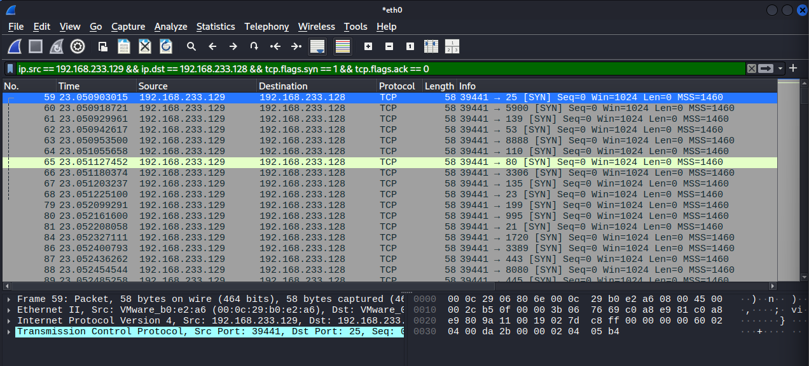
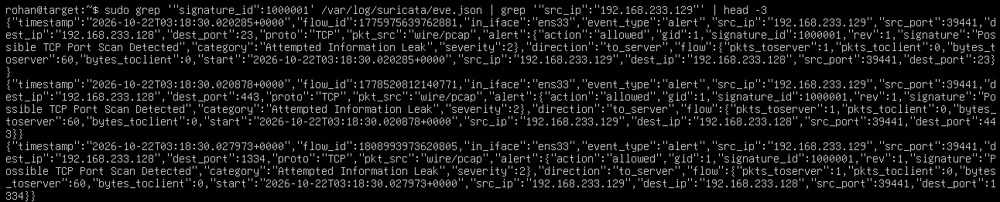
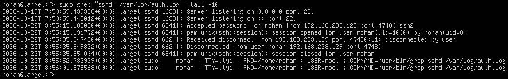

# Module 1 — Lab Environment Verification

This document confirms the lab environment is correctly built, isolated, and that all three logging/detection pipelines (packet capture, IDS alerting, auth logging) are working end-to-end before any attack-data generation begins in Module 2.

## Environment summary

- **Target:** Ubuntu Server 24.04.4 LTS, hostname `target`, user `rohan` + 7 decoy accounts (`waddams`, `mluffy`, `rozoro`, `imidoriya`, `sgojo`, `blee`, `agrande`)
- **Attacker:** Kali Linux (official pre-built VMware image)
- **Network:** VMware host-only (`VMnet1`, `192.168.233.0/24`), no NAT/internet access on the target
  - Target: `192.168.233.128`
  - Kali: `192.168.233.129`
- **Services on target:** `sshd` (logging to `/var/log/auth.log`), Suricata (ET Open ruleset + one custom local rule, logging to `/var/log/suricata/eve.json`)

## Verification method

Two separate activities were run from Kali against the target, both timestamped and captured:

1. **`nmap -sS 192.168.233.128`** — a SYN port scan, used to verify Suricata + Wireshark evidence.
2. **A real SSH login as `rohan`** — used to verify `auth.log` evidence.

These are intentionally separate. See the noise-discipline note below for why.

---

## Evidence 1: Wireshark capture of the Nmap scan

Filtered to `ip.src == 192.168.233.129 && ip.dst == 192.168.233.128 && tcp.flags.syn == 1 && tcp.flags.ack == 0` — isolates SYN-only packets from Kali to the target, which is the scan traffic itself.



Shows Kali (`192.168.233.129`) sending SYN packets to the target (`192.168.233.128`) across a spread of destination ports (3306, 1720, 8080, 587, 199, 23, 53, 25, 135, 143, 256, 5900, etc.) — the signature of a port scan, never completing a full handshake.

---

## Evidence 2: Suricata `eve.json` alert on the same scan

```json
{"timestamp":"2026-10-22T03:18:30.020285+0000","flow_id":1778957639762881,"in_iface":"ens33","event_type":"alert","src_ip":"192.168.233.129","src_port":39441,"dest_ip":"192.168.233.128","dest_port":23,"proto":"TCP","pkt_src":"wire/pcap","alert":{"action":"allowed","gid":1,"signature_id":1000001,"rev":1,"signature":"Possible TCP Port Scan Detected","category":"Attempted Information Leak","severity":2},"direction":"to_server"}
{"timestamp":"2026-10-22T03:18:30.020878+0000","flow_id":1778520812140771,"in_iface":"ens33","event_type":"alert","src_ip":"192.168.233.129","src_port":39441,"dest_ip":"192.168.233.128","dest_port":443,"proto":"TCP","pkt_src":"wire/pcap","alert":{"action":"allowed","gid":1,"signature_id":1000001,"rev":1,"signature":"Possible TCP Port Scan Detected","category":"Attempted Information Leak","severity":2},"direction":"to_server"}
{"timestamp":"2026-10-22T03:18:30.027973+0000","flow_id":1800893973620805,"in_iface":"ens33","event_type":"alert","src_ip":"192.168.233.129","src_port":39441,"dest_ip":"192.168.233.128","dest_port":1334,"proto":"TCP","pkt_src":"wire/pcap","alert":{"action":"allowed","gid":1,"signature_id":1000001,"rev":1,"signature":"Possible TCP Port Scan Detected","category":"Attempted Information Leak","severity":2},"direction":"to_server"}
```



Three alerts shown, same timestamp window as the Wireshark capture, same source/destination IPs. Signature ID `1000001` is a custom local rule (`rules/local.rules`) — see note below on why a custom rule was needed.

**Why a custom rule:** Suricata's default install ships with zero detection rules (protocol parsers only). The Emerging Threats Open ruleset was installed via `suricata-update`, but it doesn't include a generic port-scan detection signature — the rules that mention "nmap" are all for specific product exploits that happen to reference Nmap as a tool, not scan detection itself. Wrote a one-line custom rule instead: alert when a single source sends 10+ SYN packets to the target within 60 seconds.

```
alert tcp any any -> $HOME_NET any (msg:"Possible TCP Port Scan Detected"; flags:S; threshold: type threshold, track by_src, count 10, seconds 60; classtype:attempted-recon; sid:1000001; rev:1;)
```

**Known limitation, disclosed here rather than hidden:** this threshold-based rule also fires on the target's own background DNS retry traffic, since that traffic can technically match the same "many connections quickly" pattern. It correctly flags the Nmap scan, but it isn't perfectly precise — a simple threshold rule can't fully distinguish "port scan" from "any bursty traffic from one source." Worth tuning in a later pass if this gets reused.

---

## Evidence 3: `auth.log` from a real SSH login

```
2026-10-22T03:55:15.188050+00:00 target sshd[6541]: Accepted password for rohan from 192.168.233.129 port 47480 ssh2
2026-10-22T03:55:15.191772+00:00 target sshd[6541]: pam_unix(sshd:session): session opened for user rohan(uid=1000) by rohan(uid=0)
2026-10-22T03:55:35.847450+00:00 target sshd[6624]: Received disconnect from 192.168.233.129 port 47480:11: disconnected by user
2026-10-22T03:55:35.849832+00:00 target sshd[6624]: Disconnected from user rohan 192.168.233.129 port 47480
2026-10-22T03:55:35.850004+00:00 target sshd[6541]: pam_unix(sshd:session): session closed for user rohan
```



Clean accept → session opened → disconnect → session closed sequence, source IP `192.168.233.129` (Kali), confirming `sshd` is logging correctly to `/var/log/auth.log`.

---

## Noise-discipline note: why the Nmap scan has *no* matching `auth.log` lines

This is worth stating explicitly rather than leaving unexplained: the Nmap SYN scan (Evidence 1 & 2) produced **zero** `auth.log` entries, and that's correct, expected behavior — not a gap in the verification.

A SYN scan (`-sS`) never completes a TCP handshake; it sends the opening SYN packet, checks whether anything answers, and moves on without finishing the connection. `sshd` only writes to `auth.log` once an actual connection is established at the application layer, so a port scan is invisible to it by design. The scan and the SSH login above were deliberately run as two separate, independent activities for exactly this reason — pulling "matching auth.log lines" from the scan itself isn't possible, and treating that absence as a problem would miss the point.

This matters beyond Module 1: it's the basis for the detector's noise-discipline requirement later in the project (Module 2 onward) — a port scan is a network-layer event, not an authentication event, and the detector needs to NOT fire auth alerts on it. Confirming here that the two log sources already behave this way independently is useful groundwork for that.

---

**Status:** All three required evidence pieces collected from verified, working pipelines. Lab environment confirmed isolated, logging correctly, and ready for Module 2 (attack-data generation).
